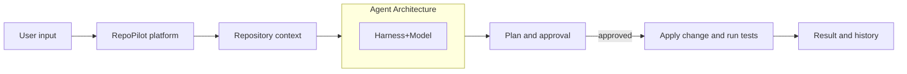

<div align="center">

  <h1>
    
    RepoPilot
  </h1>

  <h3>Repository intelligence for engineering teams.</h3>

  <p>
    
    
  </p>

</div>

RepoPilot helps teams understand and improve their software repositories. It's AI agents investigate repository related questions, connect relevant evidence, and develop actionable plans and proposed changes.

## Overview

- Inspects a GitHub repository and build a searchable code graph;
- Maps files, symbols, APIs, dependencies, and repository metadata into Neo4j;
- Retains task and investigation memory in PostgreSQL;
- Uses an LLM with the agent harness and Pydantic AI to create plans and propose changes;
- Runs approved repository tests in an isolated Docker workflow; and

## Architecture



The workflow proposes changes for approval, applies approved patches, and records the result in PostgreSQL.


## Tech Stack

<table>
    <thead>
        <tr>
            <th>Category</th>
            <th>Technologies</th>
        </tr>
    </thead>
    <tbody>
        <tr>
            <td>Frontend</td>
            <td>Angular 19, TypeScript, RxJS</td>
        </tr>
        <tr>
            <td>Backend</td>
            <td>Python 3.11+, FastAPI, Uvicorn, Pydantic Settings</td>
        </tr>
        <tr>
            <td>AI Agents</td>
            <td>Pydantic AI, Gemini/OpenRouter,GitHub MCP</td>
        </tr>
        <tr>
            <td>Data &amp; Graph</td>
            <td>PostgreSQL, SQLAlchemy, Alembic, Neo4j</td>
        </tr>
        <tr>
            <td>Parsing</td>
            <td>Tree-sitter, language packs</td>
        </tr>
        <tr>
            <td>Local Services</td>
            <td>Docker</td>
        </tr>
    </tbody>
</table>

## Prerequisites

Install Docker Desktop with Docker Compose, Python 3.11–3.13, Node.js 20 or newer with npm, and an LLM API key for Gemini or OpenRouter. A GitHub token is required for custom questions that use GitHub MCP evidence.

## Installation and setup

1. Copy `.env.example` to `.env` and set the model provider, model, and matching API key. The PostgreSQL URL and Neo4j password should match the included Docker Compose configuration. Set `GITHUB_TOKEN` only for GitHub-backed questions.

2. Start PostgreSQL and Neo4j from the repository root:

```sh
docker compose up -d
```

3. In a terminal, install and start the backend:

```sh
cd backend
python -m venv ../.venv
```

Activate `../.venv` using your shell's activation command, then run:

```sh
python -m pip install -r requirements.txt
alembic upgrade head
uvicorn app.main:app --reload --port 8000
```

4. In a second terminal, from the repository root, start the dashboard:

```sh
cd frontend
npm install
npm start
```

Open the dashboard at `http://localhost:4200`; the API is at `http://localhost:8000` and its interactive documentation is at `http://localhost:8000/docs`.


## License  
This project is licensed under the [MIT LICENSE](LICENSE).
